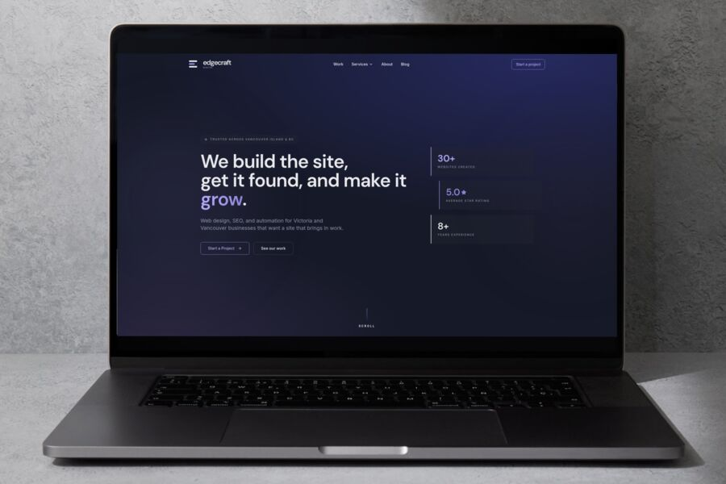
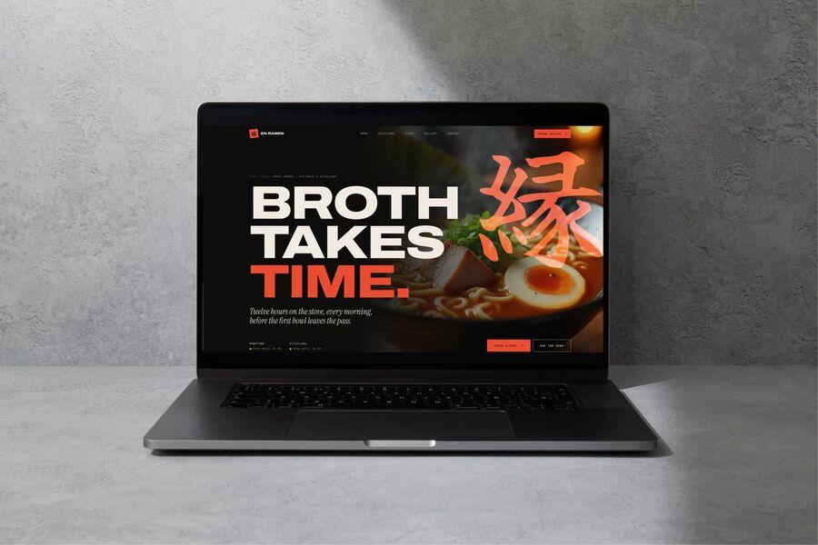
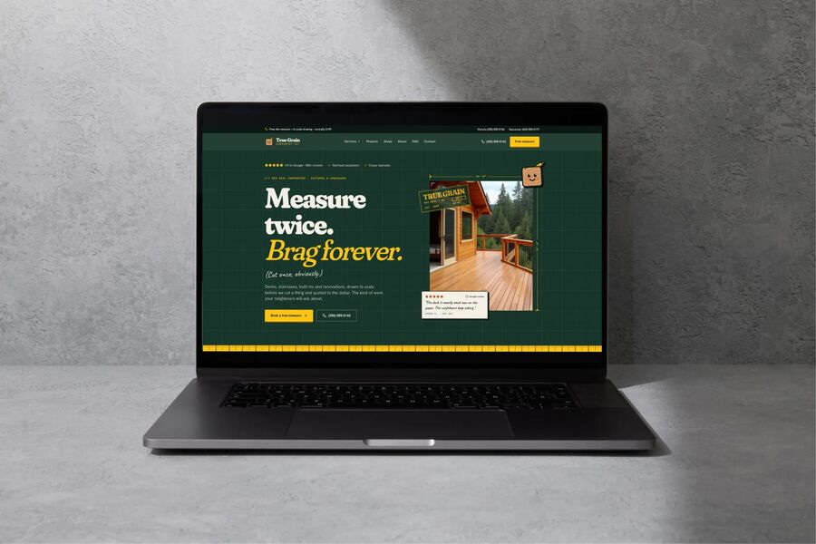

<picture>
  <source media="(prefers-color-scheme: dark)" srcset="./assets/header-dark.svg">
  <source media="(prefers-color-scheme: light)" srcset="./assets/header-light.svg">
  
</picture>

<p align="center">
  <a href="https://edgecraftdigital.com"></a>
  
  <a href="https://edgecraftdigital.com/contact"></a>
</p>

### :headphones: Now playing

I treat websites like mixes: they always sound great on my own speakers, so I check them on a phone before anyone else hears them. I run **[EdgeCraft Digital](https://edgecraftdigital.com)**, a one-person web studio in Victoria, BC. I design, build and automate fast websites for local businesses and musicians, then make sure people can actually find them. When the laptop closes, I'm making music.

```ts
const steve = {
  role: "developer, producer, studio owner",
  based: "Victoria, BC",
  trainedIn: ["Computer Science", "Music"], // one combined degree, UVic
  shipping: [
    "prerendered React + Astro sites on Cloudflare Workers",
    "Supabase backends and Airtable automations",
    "SEO that holds up: schema, sitemaps, real HTML for crawlers",
  ],
  tinkering: [
    "a Rust CLI microsite generator",
    "QML widgets for my Arch + Hyprland desktop",
  ],
  workflow: "AI agents in the loop, a human on the faders",
  motto: "Build it. Get it found. Automate the rest.",
};
```

<picture>
  <source media="(prefers-color-scheme: dark)" srcset="./assets/levels-dark.svg">
  <source media="(prefers-color-scheme: light)" srcset="./assets/levels-light.svg">
  
</picture>


### :cd: New releases

Client work lives in private repos, so here's the finished product instead. More in the [EdgeCraft portfolio](https://edgecraftdigital.com/portfolio).

<table>
<tr>
<td width="33%" valign="top">
<a href="https://edgecraftdigital.com"></a>

**[edgecraftdigital.com](https://edgecraftdigital.com)**<br>
<sub>React · Vite · Supabase · Cloudflare Workers</sub>

My studio's own site. Moved off a no-code builder onto a prerendered Worker, so every route ships as real HTML for search engines and AI crawlers.

</td>
<td width="33%" valign="top">
<a href="https://ramen-craft-vicvan.steve-afc.workers.dev"></a>

**[En Ramen](https://ramen-craft-vicvan.steve-afc.workers.dev)**<br>
<sub>React · Tailwind · Cloudflare Workers</sub>

A two-shop ramen concept: brush-kanji type subset to a few KB, bento menus, and every route prerendered for a fast first paint.

</td>
<td width="33%" valign="top">
<a href="https://coast-craft-studio.steve-afc.workers.dev"></a>

**[True Grain Carpentry](https://coast-craft-studio.steve-afc.workers.dev)**<br>
<sub>React · Tailwind · Cloudflare Workers</sub>

A carpentry concept drawn like a shop drawing: dimension lines, a cut-list services table and a tape-measure scroll bar.

</td>
</tr>
</table>

<table>
<tr>
<td width="50%" valign="top">

#### :computer: Side A: Code

- Marketing sites that load fast and rank, from first sketch to DNS cutover
- Edge-first stacks: Astro, React, Vite and Tailwind on Cloudflare Workers
- Data and workflows: Supabase, Airtable automations, Python scripts that kill spreadsheet busywork
- SEO plumbing nobody sees: prerendering, schema, sitemaps, analytics done right

</td>
<td width="50%" valign="top">

#### :control_knobs: Side B: Sound

- Producer and creator, trained in a combined Music + Computer Science program
- DSP nerd at heart: years of Max/MSP patching and audio programming
- Once wired a vintage **Buchla modular** into "the largest guitar pedal" with quad-speaker panning
- Built music tools on the Spotify API before I built websites

</td>
</tr>
</table>

### :wrench: B-sides: tools I build for myself

| Tool | Stack | What it does |
|:-----|:------|:-------------|
| **Prospect Snapshot** | Node · TypeScript | Audits a business's website (Core Web Vitals, HTTPS, titles, schema, alt text, click-to-call) and serves a one-page report before I ever pick up the phone. |
| **microsite** | Rust | A command-line generator for small, fast microsites. |
| **Desktop bar widgets** | QML · Quickshell | Hand-built widgets for my Arch + Hyprland setup: Spotify now playing, my Airtable task list, an AI usage pace meter. |
| **Airtable planner** | Node · systemd | Imports won leads and slots incoming client work into my week on a timer, so the free Airtable plan still feels automated. |

### :level_slider: The rig

<p>
  <b>Daily drivers</b><br>
  <a href="https://skillicons.dev"></a>
</p>
<p>
  <b>Also in the crate</b><br>
  <a href="https://skillicons.dev"></a>
</p>
<p>
  <b>Studio setup</b><br>
  <a href="https://skillicons.dev"></a>
</p>


### :vhs: Back catalog

Where it started. These are the public repos:

| # | Track | Genre | Liner notes |
|:-:|:------|:------|:------------|
| 01 | [**Smart-Shuffle**](https://github.com/SteveB98/Smart-Shuffle) | Python · Flask · Spotify API | My first full-stack app: reshuffles Spotify playlists by song attributes instead of pure chance. |
| 02 | [**MUS-407 Max/MSP Patches**](https://github.com/SteveB98/MUS-407-Max-MSP-Patches) | Max/MSP · DSP | The best patches from a year-long music-tech seminar at UVic. |
| 03 | [**VolunteerOrganizer**](https://github.com/SteveB98/VolunteerOrganizer) | Python · Excel automation | Schedules volunteers and generates the Excel grids so nobody has to. |
| 04 | [**Tinder-Clone**](https://github.com/SteveB98/Tinder-Clone) | React · Node · Express · MongoDB | Card swiping, auth and CSS animations. A guided build that taught me the MERN stack. |

<details>
<summary><h3>:memo: Liner notes (the long version)</h3></summary>

I came into coding as a music kid who was curious about technology. At the University of Victoria I took the **Combined Music & Computer Science** program: the core of both degrees, plus music tech, 20th-century theory, and recording and production courses.

I started as a total beginner and made plenty of mistakes. Along the way I worked in Java, Python and **Max/MSP**, the visual language built for DSP, and fell hard for the last one. I built patch after patch for music-tech case studies. For my final project I had an app send MIDI to a vintage **Buchla modular synthesizer**, turning it into "the largest guitar pedal" with quad-speaker panning and a rack of effects. In my last semester I shipped my first full-stack project, a Flask app that uses the Spotify API to reshuffle playlists by song attributes.

After graduating I taught myself web development with WordPress, Wix and React, and wrote small Python tools to automate Excel work on the job. That turned into **EdgeCraft Digital**. Today I build React and Astro sites on Cloudflare's edge, wire up Supabase and Airtable behind them, build my own tools when the off-the-shelf ones get in the way, and keep looking for the place where technical and artistic craft meet.

</details>


### :microphone: Let's make something

Need a site that loads fast and gets found, or want to jam on a music-tech idea? I'm listening.

<p>
  <a href="https://edgecraftdigital.com/contact"></a>
</p>

<p align="center"><sub>Mixed and mastered in Victoria, BC · <a href="https://edgecraftdigital.com">edgecraftdigital.com</a></sub></p>
